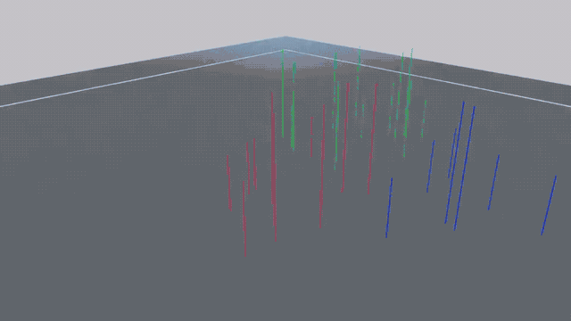
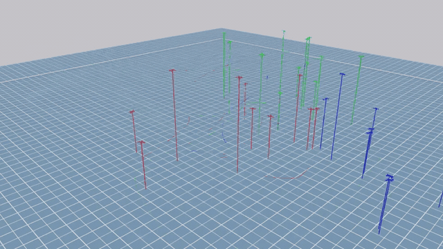
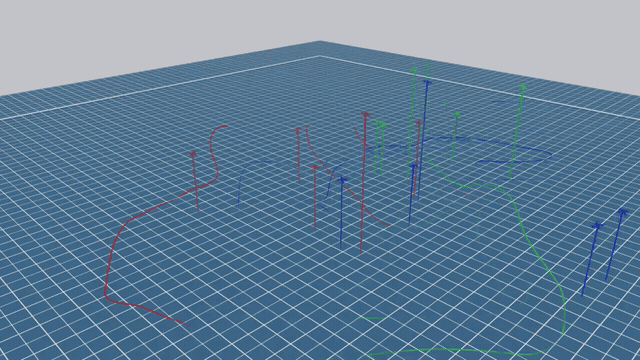
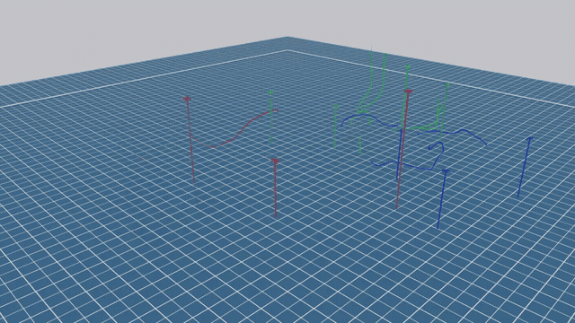

# MTAD: Multi-UAV Target–Attacker–Defender Games

MTAD is an Isaac Lab environment for multi-UAV target–attacker–defender games. Targets (T) evade attackers, attackers (A) pursue targets, and defenders (D) intercept attackers. The project implements HDC (`matd3ppo`), combining hierarchical target selection and continuous flight control, and provides MAPPO and MATD3 baselines.

## Demonstrations

<!-- BEGIN PUBLIC DEMOS -->
**30-UAV game · T/A/D = 10/12/8**

[](https://github.com/ShengKen/Full-multi-UAV-TAD-game/blob/main/media/30uav-2026-10-12_08-40-47_matd3ppo.mp4)

10 target UAVs evade 12 attacking UAVs, while 8 defending UAVs intercept the attackers. A successful capture removes both participating UAVs from the game.

**30-UAV game · T/A/D = 10/12/8**

[](https://github.com/ShengKen/Full-multi-UAV-TAD-game/blob/main/media/30uav-2026-10-06_21-27-48_matd3ppo-20261015-episode3.mp4)

10 target UAVs evade 12 attacking UAVs, while 8 defending UAVs intercept the attackers. A successful capture removes the captured UAV; the capturing UAV remains active.

**15-UAV game · T/A/D = 5/5/5**

[](https://github.com/ShengKen/Full-multi-UAV-TAD-game/blob/main/media/15uav-2026-10-05_10-38-27_matd3ppo.mp4)

5 target UAVs evade 5 attacking UAVs, while 5 defending UAVs intercept the attackers. A successful capture removes the captured UAV; the capturing UAV remains active.

**10-UAV game · T/A/D = 3/4/3**

[](https://github.com/ShengKen/Full-multi-UAV-TAD-game/blob/main/media/10uav-2026-10-02_15-21-30_matd3ppo.mp4)

3 target UAVs evade 4 attacking UAVs, while 3 defending UAVs intercept the attackers. A successful capture removes both participating UAVs from the game.
<!-- END PUBLIC DEMOS -->

## Methods

| Method | Implementation |
| --- | --- |
| `matd3ppo` (HDC) | High-level discrete MAPPO target selection with low-level continuous MATD3 control |
| `mappo` | Multi-agent PPO |
| `matd3` | Multi-agent TD3 |

In hierarchical mode, each physical UAV has a high-level `/dec` agent and a low-level `/ctrl` agent. Observations, rewards, team sizes, and evaluation settings are defined by each run's saved configuration.

## Setup and artifact access

Install compatible Isaac Sim, Isaac Lab, and NVIDIA GPU drivers, then install this extension using the Python environment provided by Isaac Lab. Use each experiment's saved configuration when loading its checkpoint.

Checkpoints and MP4 files use Git LFS. Download the files for the desired run while retaining the published directory structure. Original recordings are retained in each run's `play/` or `play_eval/` directory.

## Small-scale training example

The command below uses the container's Isaac Lab Python launcher. Replace `/isaac-sim/python.sh` with the launcher for your installation if needed.

```bash
/isaac-sim/python.sh scripts/train_tad.py \
  --config configs/tad_hierarchical_config.yaml \
  --algo matd3ppo --num_envs 16 --timesteps 1000 \
  --headless --no_wandb --livestream 0
```

This is a short training example. Reproducing a particular experiment requires its saved configuration and evaluation protocol. The playback entry point, `scripts/play_tad_hierarchical.py`, automatically looks for `run_config.yaml` and `drone_config.yaml` beside the selected checkpoint's training run.

## Project structure

| Path | Purpose |
| --- | --- |
| `source/MTAD/MTAD/tasks/direct/tad_hierarchical/` | Environment and environment configuration |
| `source/MTAD/MTAD/algorithms/` | Policy and training implementations |
| `configs/` | Default configurations and publication catalog |
| `scripts/train_tad.py` | Training entry point |
| `scripts/play_tad_hierarchical.py` | Playback, evaluation, and recording |
| `scripts/prepare_public_artifacts.py` | Artifact selection and demonstration gallery generation |
| `media/` | Homepage previews and demonstration clips |

## Updating the release

The publication catalog is `configs/public_artifacts.json`. Update its `featured_videos` list to choose and order recordings, then use `scripts/prepare_public_artifacts.py` to regenerate the gallery. Previews are stored in `media/`; publication manifests remain local under `logs/public_artifacts/`. The script does not train or evaluate policies, commit changes, or push to Git.
